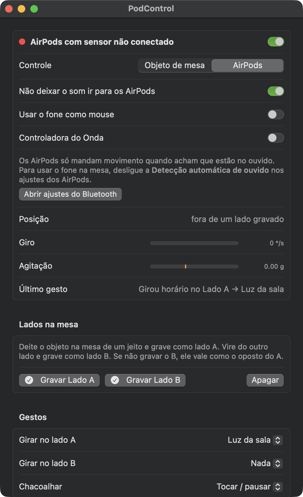

# PodControl

Transforma um AirPod em controle do Mac. Com o fone deitado na mesa:

- **girar** no lado A controla uma coisa (padrão: volume);
- **virar do outro lado e girar** controla outra (padrão: brilho da tela);
- **chacoalhar** dispara uma ação (padrão: abrir um app escolhido).

Cada gesto pode receber outra ação no painel: volume, brilho, rolar a página, trocar de aba, tocar/pausar, próxima ou anterior faixa, mudo, Mission Control, abrir um app e, se você configurar, luzes do Home Assistant e volume de um Echo (Alexa).



## Instalação

### 1. O que você precisa

- Um Mac com **macOS 14 (Sonoma)** ou mais novo.
- AirPods com rastreamento de cabeça: **AirPods 3, AirPods 4, AirPods Pro ou AirPods Max**.
- As ferramentas de linha de comando da Apple (trazem o Swift). Se nunca instalou, rode no Terminal:

  ```bash
  xcode-select --install
  ```

  e clique em **Instalar** na janela que aparecer. Não precisa do Xcode completo.

### 2. Baixar e compilar

```bash
git clone https://github.com/itslauxen/podcontrol.git
cd podcontrol
./build.sh
```

O `build.sh` compila e gera o `PodControl.app` nesta pasta. A primeira compilação leva um ou dois minutos.

### 3. Abrir

```bash
mv PodControl.app /Applications/
open /Applications/PodControl.app
```

O app fica na barra de menus (ícone de AirPods). O painel abre junto; depois, abra pelo ícone › **Abrir painel**.

### 4. Preparar os AirPods

Os AirPods só mandam movimento quando acham que estão no ouvido. Para usar o fone deitado na mesa:

1. Abra **Ajustes do Sistema** › nome dos seus AirPods (com eles conectados).
2. Desligue **Detecção automática de ouvido**.

### 5. Primeiro uso

1. Na primeira vez, o macOS pede a permissão de **Movimento e Condicionamento**. Aceite.
2. Tire um AirPod do ouvido e deixe fora do estojo. A bolinha do painel fica verde quando chega movimento.
3. Deite o fone na mesa e clique **Gravar Lado A**. Vire do outro lado e clique **Gravar Lado B**.
4. Em **Gestos**, escolha o que cada gesto faz.
5. Gire o fone sobre a mesa. Sentido horário aumenta, anti-horário diminui.

Se escolher rolar a página, trocar de aba, teclas de mídia ou o modo mouse, o painel mostra o botão **Liberar Acessibilidade**: clique e ative o PodControl em Ajustes do Sistema › Privacidade e Segurança › Acessibilidade.

## Integrações (opcionais)

Ficam na seção **Integrações**, no fim do painel. Sem elas, o resto do app funciona normalmente.

### Home Assistant (luzes)

1. No Home Assistant, abra seu **Perfil › Segurança › Tokens de acesso de longa duração** e crie um token.
2. No painel do PodControl, abra **Home Assistant** e preencha:
   - **Endereço**: por exemplo `http://homeassistant.local:8123` ou `http://192.168.1.10:8123`;
   - **Token**: o que você acabou de criar;
   - **Luz 1** e **Luz 2**: um nome para aparecer no app e o `entity_id` da luz (ex.: `light.sala`). Um grupo de luzes também serve.
3. Em **Gestos**, escolha a luz pelo nome que você deu.

Na primeira vez, o macOS pergunta se o PodControl pode acessar a rede local. Aceite.

### Alexa (volume de um Echo)

Usa a API não oficial da Amazon, por meio do [alexa-remote-control](https://github.com/thorsten-gehrig/alexa-remote-control). Dá um pouco mais de trabalho:

1. Instale o `jq`: `brew install jq` (precisa do [Homebrew](https://brew.sh)).
2. Baixe o script para o lugar onde o app procura:

   ```bash
   mkdir -p ~/.local/share/alexa-remote-control
   curl -fsSL https://raw.githubusercontent.com/thorsten-gehrig/alexa-remote-control/master/alexa_remote_control.sh \
     -o ~/.local/share/alexa-remote-control/alexa_remote_control.sh
   chmod +x ~/.local/share/alexa-remote-control/alexa_remote_control.sh
   ```

3. Gere um *refresh token* da sua conta Amazon com o [alexa-cookie-cli](https://github.com/adn77/alexa-cookie-cli/releases): rode o programa, faça login na página que ele abrir e copie o token que começa com `Atnr|`.
4. No painel do PodControl, abra **Alexa** e preencha:
   - **Nome do Echo**: exatamente como aparece no app Alexa;
   - **Domínio da Amazon**: `amazon.com.br`, `amazon.com`, `amazon.de`…;
   - **Refresh token**: o do passo 3.

O volume leva cerca de 1 segundo por comando, então a tela acompanha o giro e o Echo recebe o valor final.

## Objeto de mesa (opcional)

Em vez dos AirPods, dá para usar um objeto feito com **ESP32 + MPU6050**, que conversa com o Mac por Bluetooth LE.

- Firmware: `firmware/podcontrol_objeto/podcontrol_objeto.ino` (Arduino IDE com a placa ESP32; as ligações estão no topo do arquivo).
- Caixa para imprimir em 3D: `case/` (`base.stl`, `tampa.stl` e o fonte em OpenSCAD).
- No painel, troque **Controle** para **Objeto de mesa**. Ele aparece no Bluetooth como PodControl e conecta sozinho. O macOS pede a permissão de Bluetooth.

## Outros modos

- **Usar o fone como mouse**: com a haste apontada para a tela, o fone move o cursor; um aperto na haste clica, dois apertos são o clique direito.
- **Não deixar o som ir para os AirPods**: se o macOS mandar o som para o fone que está servindo de controle, o app volta para o alto-falante do Mac.
- **Controladora do Onda**: cria um aparelho MIDI virtual chamado PodControl para a cabine de DJ do Onda. Fora dela, pode ignorar.

## Problemas comuns

- **A bolinha não fica verde**: confira se a detecção automática de ouvido está desligada e se o fone está fora do estojo. Colocar e tirar o fone do ouvido uma vez às vezes acorda o sensor.
- **"O app está danificado" ou "não pode ser aberto"**: acontece se você copiou o `.app` pronto de outra pessoa em vez de compilar. Rode `xattr -dr com.apple.quarantine /Applications/PodControl.app`, ou compile você mesmo com `./build.sh`.
- **A Acessibilidade parou de funcionar depois de recompilar**: sem um certificado de desenvolvedor, o app é assinado *ad hoc* e o macOS o trata como app novo a cada compilação. Em Ajustes › Acessibilidade, remova o PodControl (botão −) e libere de novo.
- **O brilho não muda**: só controla a tela interna do MacBook (usa o framework privado DisplayServices, porque a Apple não tem API pública para isso).

## Permissões

- **Movimento e Condicionamento**: para ler o sensor dos AirPods.
- **Bluetooth**: só com o objeto de mesa.
- **Rede local**: só com o Home Assistant.
- **Acessibilidade**: só para rolar, trocar de aba, teclas de mídia e o modo mouse.

Volume, brilho, mudo, Mission Control e abrir app não pedem permissão. Os tokens das integrações ficam nas preferências do app, só no seu Mac (`~/Library/Preferences/dev.lauxen.podcontrol.plist`).

## Para desenvolver

- `swift test` roda os testes do reconhecimento de gestos (não precisa de AirPods).
- `Sources/Gestos/` é a lógica pura: descobre o lado pela direção da gravidade, mede o giro em torno da vertical e conta trancos para a chacoalhada.
- `Sensor.swift` lê o `CMHeadphoneMotionManager` (ou o objeto, em `FonteObjeto.swift`).
- `Acoes.swift` executa as ações; `HomeAssistant.swift` e `Alexa.swift` são as integrações; `HUD.swift` mostra o aviso flutuante.
